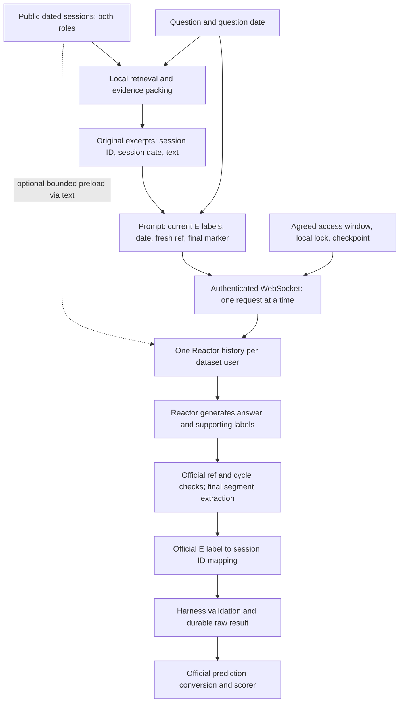

# Reactor deep dive: API, memory, and our harness

Audit started 2026-10-30; offline implementation continued 2026-10-31. Scope:
the organizer kit pinned by `bootstrap.py` to
`f0a317dfa13e7797baae61711cef27a9805bedcc`, our feature branch, and preserved live
artifacts. No live request was made for this audit. This report describes the
client-visible contract, not Reactor's undisclosed implementation.

## The strategic finding

**We currently use Reactor mainly as the final answer generator in external RAG.**
`runtime.py` retrieves original excerpts locally and sends them with each question.
At the start of this audit it preserved one Reactor history per dataset history,
so earlier questions, excerpts, and replies could persist, but it never deliberately
ingested history with `--text`. Evidence-first remains the default. The new opt-in
`--memory-mode targeted` pilot pools bounded verbatim excerpts across a user's
public questions and preloads them before answering. This exercises the documented
memory path; we have not established a performance benefit from it.

That is a legitimate solution under the rules, but retrieval scores do not prove
effective use of Reactor's distinctive memory, successful end-to-end answers, or
the three four-point judging categories. The most valuable next experiments are
the final-answer citation gate, a paired retrieval comparison through Reactor,
and a bounded source-linked memory preload comparison. See
[the strategy comparison](REACTOR_STRATEGIES.md) and
[the executable experiment plan](REACTOR_EVALUATION.md).

## What Reactor is, and what we cannot see

The challenge supplies a team-specific hosted **stateful agent**, reached through
HTTP and a WebSocket. The official README describes long-term memory, public web
browsing, asynchronous replies, and a fast instruct model. It does not disclose
model weights, context size, memory indexing, compression, retention algorithms,
token pricing, or internal tools. We cannot equate its memory with an unlimited
context window or assume perfect recall. [Official README](../official/README.md),
[participant contract](../official/reactor/PARTICIPANTS.md).

The documented promise is strong: within a Reactor history the agent keeps what
it has seen; between histories it keeps nothing. This establishes the intended
lifecycle, not a measured recall guarantee. Exactly what is stored physically and
how information is recovered remain unknown.

## Two meanings of history

| Name | Meaning | Owner |
| --- | --- | --- |
| Dataset history `h_…` | Public input: a user's dated sessions, containing user and assistant turns | Dataset |
| Reactor history, opaque server ID | The current isolated state of our single hosted agent | Server |

The server exposes one active history per agent. `--new-history` replaces it;
it is not a constructor for another concurrently usable conversation. It clears
memory, chat history, pending input, and late replies; agent configuration stays.
A request naming a replaced history is refused with `history_changed`. There is
no documented restore, list-history, fork, read-memory, or attach-to-old-history
API. Do not adopt a server-reported ID: it may belong to another user's work.
[Client module contract and `new_history`](../official/reactor/client.py),
[history workflow](../official/reactor/PARTICIPANTS.md).

The required workflow is one Reactor history per dataset history, every question
for that user sequentially, reset only when changing users. Earlier evidence and
answers can help later questions but can also introduce stale answers, irrelevant
facts, or old citation labels. Dev often has only one question per user; the
hidden test has about ten, making stateful behavior a separate transfer risk.

## How a question travels



1. `POST /agents/{agent_id}/history`, empty body and bearer authorization, returns
   a new history ID plus lifecycle metadata. The client passes that ID through.
2. The question uses `wss://HOST/agents/{agent_id}/ws/chat?history=ID`, also with
   bearer authorization. It sends JSON `{"type":"message","text":"…"}`.
3. `build_message` includes the question, normalized question date, `[E1]` etc.,
   each excerpt's supplied source ID and session date, and a fresh eight-hex ref.
   The dataset `question_id` is echoed locally for bookkeeping; **it is not sent
   to the model**. Session IDs and dates are ordinary prompt text, not a structured
   server memory schema.
4. A matching `ack.text` establishes the queued input's cycle. The client accepts
   replies only from a later integer cycle. Interim replies and final answers to
   other refs are preserved separately. A ref is a model-written text marker,
   not a server request ID or an idempotency key.
5. The current marked final answer is extracted, and only labels inside that
   extracted answer are mapped against the current passage list.

These details come from [`ask`, `ask_retrying`, `build_message`, and `main` in
the client](../official/reactor/client.py). We reuse those functions rather than
inventing another transport or answer parser.

## Example: the cat-name question

The preserved live question `q_d4ead82e5cad` asks “What is the name of my cat?”
as of `2023/05/30 (Tue) 12:18`. Our retriever supplied a dated excerpt containing
the user's statement that the cat is Luna, with its real session ID under `[E1]`.
The client normalized the question date to `2023-05-30 12:18`, told Reactor to
ignore its real clock, and requested ref `56451236`.

Reactor produced a narrative identifying Luna and citing `[E1]`, then:

```text
# FINAL ANSWER [ref:56451236]: Luna
```

The official parser extracted `Luna`; its citation mapper saw no labels in that
segment. The prediction therefore had `answer: "Luna"` and `citations: []`.
The local official scorer matched the answer, but Evidence F1 was zero. A valid
target is Reactor itself emitting `Luna [E1]` after the marker. Moving the earlier
citation into predictions would fabricate output and is prohibited.
[Unchanged raw result](live-smoke-20261030T2135/results.jsonl),
[unchanged prediction](live-smoke-20261030T2135/predictions.jsonl).

## Answer, citation, and abstention semantics

The guide says “only that line counts.” The implementation is slightly broader:
`final_answers` extracts the **segment from a line-start marker until the next
marker or the end of that reply**, including subsequent lines. Repeated refs in
one reply keep the last segment. We request a single concise physical line to
avoid depending on that extra tolerance.

Citation labels are case-sensitive `E` plus a number inside brackets. The parser
accepts `[E1] [E2]` and `[E1, E2]`, sorts and deduplicates label numbers, then maps
them to this call's passage IDs. The official prediction adapter removes labels
and deduplicates session IDs. Multiple excerpts from one session count as one
session citation. Unknown labels, null IDs, and turn IDs cannot become valid
scored session evidence. Our harness additionally checks the question's own
history and exact evidence mapping.

**Memory is not a citation channel.** An answer asked with no evidence has no
mapped citations even if the agent remembers a session ID. Preloading must still
be paired with original evidence for scored answers. Label numbers restart on
each question: an earlier `[E1]` can refer to an entirely different source now.

The official client detects abstention when the extracted answer begins with
`INSUFFICIENT_EVIDENCE` (case-insensitive, with leading punctuation tolerated).
Our harness uses the official adapter's `agent` abstention option. A timeout,
disconnect, refused request, or malformed response is an operational failure,
never automatically a submitted abstention.
[Parser](../official/reactor/client.py),
[prediction adapter](../official/reactor/predictions.py).

## Native memory, loading, and browsing

`--text` sends verbatim text without the question template or a final marker.
After a matching ack it waits for the first eligible reply. It can load dated,
source-labelled sessions oldest first. Every part is a full agent turn: wait for
its acknowledgement reply before the next. An “OK” confirms a reply occurred;
it does not verify accurate storage or future recall. All loaded material is lost
on the next reset. Additional context or intermediate reasoning is allowed, but
there is no documented memory-write API distinct from ordinary messages.

The agent can browse public pages, including a team's public search endpoint.
This is potentially distinctive: Reactor could decide what memory to retrieve
instead of merely receiving a fixed shortlist. Tool-call schemas, navigation
limits, reliability, and structured browsing traces are not supplied by this kit;
the feature needs a controlled live test. No private conversations should be
published as part of an unapproved search-service experiment.
[Loading and browsing contract](../official/reactor/PARTICIPANTS.md).

## Limits, failures, and safe retries

| Item | Documented/source behavior | Consequence |
| --- | --- | --- |
| Message size | 16,000 characters client default; server 32,000 at event start, subject to announcements | Count the complete rendered prompt; raising the flag cannot override server limits |
| Latency | Typically tens of seconds; default timeout 300 s | Preloads and extra stages multiply latency |
| Parallelism | Across separate agents only | One designated live runner for our single agent |
| Safe retry | `busy` or `previous_pending` AND `forwarded` exactly false | Official backoff 1, 2, 4, 8 s, capped at 8, inside the same total timeout |
| Other failures | `history_changed`, `history_resetting`, too-large, timeout, closed, connect/reset errors | Stop and classify; never assume no forwarding without evidence |
| Timeout | Bounds async answer wait and its retries | Does not cancel or undo an already accepted server message |
| Reset HTTP timeout | Outcome can be uncertain | Do not blindly repeat a reset after a crash |
| Rate limits | No numeric request quota or token budget in inspected kit | No claim of unlimited access |

`previous_pending` may simply mean the agent is finishing its previous thought.
Resetting to clear it would destroy required same-user memory. A local lock
protects cooperating local processes; only a mutually agreed exclusive window
can address another machine. See [reliability status](REACTOR_RELIABILITY.md).

## What we use and what remains open

We already use dated evidence from both roles, exact question dates, sequential
history grouping, asynchronous final-ref parsing, official citation conversion,
dry runs, checkpoints, local locking, and failure preservation. The calibrated
retriever and BM25 controls are local computation; neither measures Reactor's
answer accuracy or actual citation selection.

Underused capabilities are deliberate memory ingestion, memory reuse across
multiple questions, bounded reasoning/preparation turns, and agent-driven public
search. The highest-value API opportunity is first **correctly cited reliable
completion**, then proving whether a compact preload improves multi-question
behavior enough to justify its cost. Full-history loading and extra reasoning
turns remain hypotheses, not defaults.

The implemented preload uses public future question topics to select context.
It is a query-aware C/D hybrid, not query-independent fact extraction or full
native-history ingestion. This first ablation tests the complete preload policy;
any gain could reflect extra context or an extra turn rather than persistence
itself. A matched-context follow-up is needed to isolate the mechanism.

## Judging implications

| User-provided criterion | Credible demonstration to build | Evidence still required |
| --- | --- | --- |
| IDEA / 4 | Source-linked evolving memory; selective original-evidence recall; possibly Reactor-directed search | Paired evidence that memory changes behavior usefully, beyond ordinary RAG |
| HARNESS / 4 | Isolated state, honest failures, exact citation provenance, reproducible run artifacts | Completed live smoke and paired results with actual evidence F1, latency, failures |
| APPLICATION / 4 | Auditable customer/account memory that distinguishes user facts, recommendations, updates, and unknowns | Separate product team validates workflow, value, and business narrative |

This workstream builds the technical foundation and records product opportunities
in [DEMO_OPPORTUNITIES.md](DEMO_OPPORTUNITIES.md). It does not build a frontend or
claim any judging points have been awarded. The official README does not specify
a benchmark-to-rubric conversion; the three four-point criteria here come from
the user's event rubric.

## Offline completion record

The integrated suite passes **99 tests**, including a full runner-to-official-
scorer simulation with network transports replaced. The frozen local plan is
`runs/reactor-experiment-plan-final/plan.json`: its paired stage costs 95 initial
operations; all proposed stages cost 107. Maximum prepared question size is
13,656 characters and maximum preload part is 10,649, below the default limit.
[The validation record](reactor-deep-dive/offline-validation.json) preserves exact
selection, counts, source hashes, and limitations. No new live calls were made.
The unchanged historical prediction still has a correct local answer and zero
Evidence F1. New prompt reliability, memory benefit, and awarded judging points
remain unproven.
